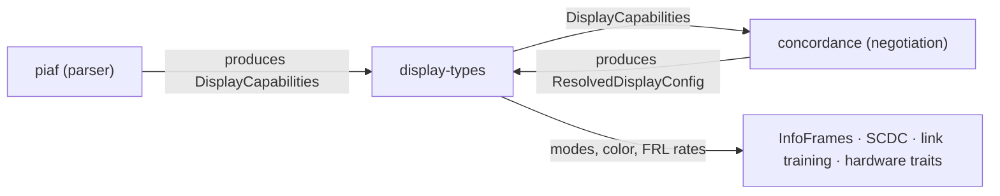

# display-types

[](https://github.com/ashlar-display/display-types/actions/workflows/ci.yml)
[](https://crates.io/crates/display-types)
[](https://docs.rs/display-types)
[](LICENSE)
[](https://blog.rust-lang.org/2025/02/20/Rust-1.85.0.html)
[](https://slsa.dev)
[](#verifying-releases)

> **Part of [Ashlar](https://ashlar-display.org)** — a display connection stack in Rust,
> HDMI 2.1 first: from EDID parsing through mode negotiation to FRL link training.
> See [all crates](https://ashlar-display.org/crates.html).

Shared display capability types for display connection negotiation.

This crate provides [`DisplayCapabilities`] and all its supporting types —
the stable, typed model that EDID/DisplayID parsers produce and negotiation
engines consume. It is the shared vocabulary between
[piaf](https://crates.io/crates/piaf) (the parser) and
[concordance](https://crates.io/crates/concordance) (the negotiation engine),
and is suitable for any crate that needs to describe display capabilities without
taking a dependency on a full parser.

## Usage

```sh
cargo add display-types
```

For `no_std` with heap allocation (e.g. embedded with an allocator):

```sh
cargo add display-types --no-default-features --features alloc
```

For bare `no_std` (scalars only):

```sh
cargo add display-types --no-default-features
```

Look up a CTA-861 Video Identification Code; this works in every build, `no_std` without
`alloc` included:

```rust
use display_types::RefreshRate;
use display_types::cea861::vic_to_mode;

let mode = vic_to_mode(16).expect("VIC 16 is 1920×1080p60");
assert_eq!((mode.width, mode.height), (1920, 1080));
assert_eq!(mode.refresh_rate, Some(RefreshRate::integral(60)));
assert!(!mode.interlaced);
```

## Feature flags

| Flag    | Default | Description                                                               |
|---------|---------|---------------------------------------------------------------------------|
| `std`   | yes     | Enables `std`-dependent types; implies `alloc`.                           |
| `alloc` | no      | Enables heap-allocated types (`Vec`, `Arc`, `String`) without full `std`. |
| `serde` | no      | Derives `Serialize`/`Deserialize` for all public types.                   |

With neither `std` nor `alloc` the crate compiles in bare `no_std` mode and
exposes only the scalar types (enums and copy structs).

## Stack position



display-types depends on no other Ashlar crate; every other
[Ashlar crate](https://ashlar-display.org/crates.html) depends on it. The capability model
lives here rather than in the parser, so negotiation does not depend on the parser; the
resolved configuration lives here rather than in the negotiation engine, so drivers and
InfoFrame encoders do not depend on negotiation.

## Out of scope

- **Parsing EDID and DisplayID** — piaf decodes the bytes into these types.
- **Choosing a configuration** — ranking modes and checking them against source and cable
  limits is concordance's.
- **Correcting display data** — the types hold what the display declares; quirk fixes and
  resolving contradictions belong to the parser or the negotiation engine.
- **Encoding for the wire** — InfoFrames, SCDC registers and PHY settings are built from
  these types in their own crates.

## Documentation

- [`doc/architecture.md`](doc/architecture.md) — role, the two models, modules, builds and
  design rules
- [`doc/setup.md`](doc/setup.md) — build, test, `no_std`, MSRV and coverage commands
- [`doc/testing.md`](doc/testing.md) — what the tests check and how CI runs them
- [`doc/roadmap.md`](doc/roadmap.md) — what comes next
- [`CONTRIBUTING.md`](CONTRIBUTING.md) — how to contribute

## Verifying releases

Releases are built on GitHub Actions and attested with
[SLSA Build Level 2](https://slsa.dev) provenance (from 0.4.0). To verify a release
`.crate` against its signed provenance, install the
[GitHub CLI](https://cli.github.com/) and run:

```sh
gh attestation verify display-types-X.Y.Z.crate --repo ashlar-display/display-types
```

Releases from before the repository moved to the `ashlar-display` organization (0.4.0 to
0.4.2) were attested under its previous owner, and verify against it:

```sh
gh attestation verify display-types-X.Y.Z.crate --owner DracoWhitefire \
  --signer-repo DracoWhitefire/display-types
```

The attested `.crate` is attached to each
[GitHub release](https://github.com/ashlar-display/display-types/releases).

Releases from 0.4.1 are uploaded through crates.io
[trusted publishing](https://rust-lang.github.io/rfcs/3691-trusted-publishing-cratesio.html): the publish
workflow obtains a short-lived token via OpenID Connect instead of using a stored
API token. Since 0.4.1 was released, crates.io also rejects uploads made with an
API token for this crate (the badge above reflects that setting). Each version's
publishing details, including the workflow run and commit, are available from the
crates.io API:

```sh
curl -A "your-tool (contact)" https://crates.io/api/v1/crates/display-types/X.Y.Z
# see .version.trustpub_data
```

Versions up to 0.3.1 were uploaded with an API token (mostly from CI) and carry no
provenance; 0.4.0 carries provenance but was also uploaded with an API token.

## License

Licensed under the [Mozilla Public License 2.0](LICENSE).
